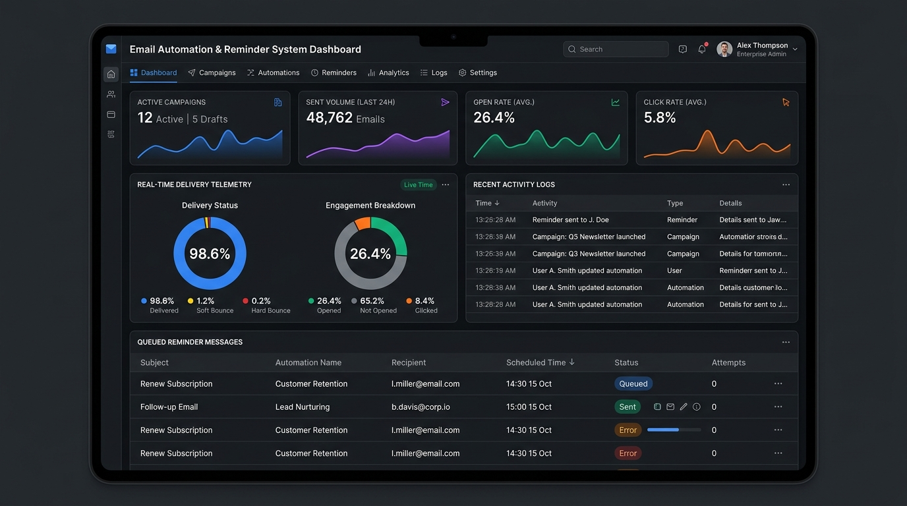
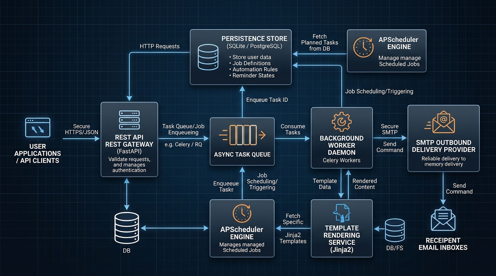
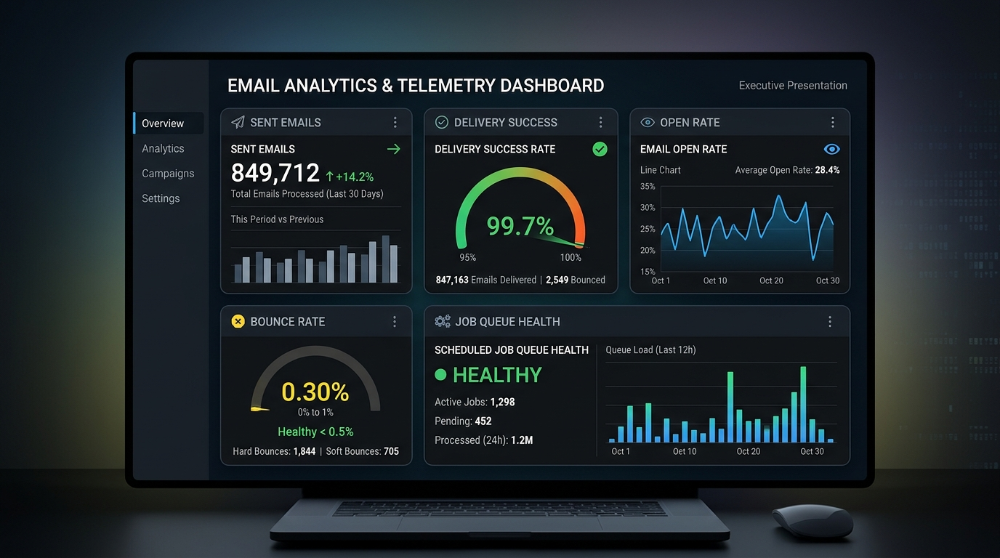

# Email Automation and Reminder System

An enterprise-grade, asynchronous email automation and reminder scheduling platform designed for reliable customer communications, lifecycle triggers, dynamic template rendering, and delivery analytics.

---

## 1. Executive Summary

Modern enterprise operations require reliable, automated, and observable communication pipelines. The Email Automation and Reminder System eliminates manual outreach bottlenecks by providing an event-driven framework that bridges scheduling engines, dynamic content personalization, and real-time delivery telemetry.

Key operational outcomes:
* Operational Efficiency: Reduces manual follow-up workloads by automating routine notifications, billing reminders, and lifecycle nudges.
* Reliability: Transaction-safe database queues prevent duplicate dispatches and handle automatic retry backoff for transient network failures.
* Observability: Complete visibility into dispatch lifecycles, confirmed delivery outcomes, recipient open rates, and failure diagnostics.
* Safe Development: Built-in mock execution mode allows staging and local functional verification without incurring external email provider charges or sending unintended messages.

---

## 2. Visual Overview and Screenshots

The platform includes an administrative interface, event-driven architecture, and real-time metric tracking. Visual assets are stored directly in the repository under the `images/` directory.


Figure 1: Real-time analytics dashboard with dynamic metrics and activity audit feed.


Figure 2: Component topology showing decoupling between API gateway, worker daemon, scheduler, and frontend.


Figure 3: Summary cards tracking sent volume, delivery success percentage, open rates, and scheduler health.

---

## 3. System Architecture and Component Topology

The system separates high-throughput API ingestion from background execution to guarantee system resilience:

1. Web Ingestion and API Tier: Built with FastAPI, handling RESTful requests for immediate dispatches, template authoring, and reminder scheduling.
2. Background Processing Worker: An asynchronous polling daemon that continuously queries the persistence store for due reminders, locks records using transaction boundaries, and dispatches via SMTP.
3. Scheduling Engine: Powered by APScheduler, coordinating one-time date triggers and periodic batch workflows.
4. Dynamic Templating Engine: Utilizes Jinja2 with strict syntax parsing, HTML auto-escaping, and runtime context substitution.
5. Inbound Webhook Listener: Ingests delivery receipts, bounce notifications, and open events from external SMTP providers.
6. Administrative Dashboard: Next.js frontend with Tailwind CSS cards, live activity logs, and metric aggregations.

---

## 4. Repository Structure

```text
email-automation/
|-- api/
|   |-- __init__.py           # Package exports for schemas and dependencies
|   |-- dependencies.py       # FastAPI dependency injection for DB and services
|   |-- endpoints.py          # REST controllers for emails, templates, and reminders
|   |-- schemas.py            # Pydantic v2 validation contracts
|   \-- webhooks.py           # Inbound delivery and interaction webhooks
|-- apps/
|   \-- web/                  # Next.js frontend dashboard
|       |-- app/
|       |   |-- globals.css   # Tailwind CSS base and utility directives
|       |   |-- layout.tsx    # Application root layout
|       |   \-- page.tsx      # Interactive analytics dashboard and dispatch UI
|       |-- package.json      # Node.js dependencies
|       |-- postcss.config.js # PostCSS configuration
|       |-- tailwind.config.js# Tailwind CSS configuration
|       \-- tsconfig.json     # TypeScript configuration
|-- db/
|   |-- __init__.py           # Database package exports
|   |-- base.py               # Declarative base model definition
|   \-- database.py           # SQLAlchemy engine, session maker, and scoped session
|-- docs/                     # Technical specifications and architectural records
|   |-- architecture.md       # High-level architecture and system design
|   |-- data_flow.md          # End-to-end data pipelines and transformation contracts
|   |-- dataset_and_schemas.md# Dataset schemas, PII rules, and validation specs
|   |-- execution_log.md      # Chronological engineering log
|   |-- model_and_learning.md # Intelligence tier and evaluation metrics
|   |-- modules.md            # Module breakdown and class responsibilities
|   |-- README.md             # Documentation directory index
|   \-- validation_and_testing.md # Testing protocols and verification gates
|-- images/                   # Screenshots, architecture diagrams, and static assets
|   |-- .gitkeep              # Version control placeholder
|   |-- analytics_metrics.png # Telemetry and performance metric screenshot
|   |-- dashboard_overview.png# Administrative UI preview
|   \-- system_architecture.png# Decoupled component architecture diagram
|-- outputs/                  # Local execution logs and output dumps
|   \-- .gitkeep
|-- src/
|   |-- __init__.py           # Core business logic exports
|   |-- email_service.py      # Mailer alias module
|   |-- mailer.py             # Asynchronous SMTP client with mock mode fallback
|   |-- models.py             # SQLAlchemy ORM models
|   |-- scheduler.py          # APScheduler AsyncIOScheduler wrapper
|   \-- template_service.py   # Jinja2 rendering and syntax verification engine
|-- .env.example              # Environment variable template
|-- .gitignore                # Version control exclusions
|-- main.py                   # FastAPI application entrypoint
|-- requirements.txt          # Python dependencies
|-- run_worker.py             # Background reminder worker process
\-- test_simulation.py        # Programmatic end-to-end simulation script
```

---

## 5. Technology Stack

* Backend Framework: Python 3.10+, FastAPI, Uvicorn
* Data Access Layer: SQLAlchemy ORM 2.0+, SQLite (default) or PostgreSQL
* Task Scheduling: APScheduler (AsyncIOScheduler)
* Mail Protocol: aiosmtplib (supporting TLS, STARTTLS, and SSL)
* Template Rendering: Jinja2
* Validation Contracts: Pydantic v2 with email-validator
* Frontend: Next.js 14 (App Router), React 18, TypeScript, Tailwind CSS

---

## 6. Installation and Setup

### Prerequisites
* Python 3.10 or higher
* Node.js 18 or higher with npm

### Step 1: Clone Repository and Create Virtual Environment
```bash
git clone https://github.com/your-username/email-automation-system.git
cd email-automation-system

python -m venv venv
```

Activate the virtual environment:
* Windows (PowerShell):
  ```powershell
  .\venv\Scripts\activate
  ```
* Linux / macOS:
  ```bash
  source venv/bin/activate
  ```

### Step 2: Install Python Dependencies
```bash
pip install -r requirements.txt
```

### Step 3: Install Frontend Dependencies
```bash
cd apps/web
npm install
cd ../..
```

### Step 4: Configure Environment Variables
Copy `.env.example` to `.env`:
* Windows (PowerShell):
  ```powershell
  Copy-Item .env.example .env
  ```
* Linux / macOS:
  ```bash
  cp .env.example .env
  ```

Configuration parameters:
* APP_ENV: Deployment environment mode (development, staging, production).
* USE_MOCK_EMAIL: Set to True for testing without an external SMTP server. Set to False in production.
* DATABASE_URL: Database connection string (defaults to sqlite:///./email_automation.db).
* SMTP_HOST: SMTP server hostname (example: smtp.gmail.com or smtp.sendgrid.net).
* SMTP_PORT: SMTP port (587 for STARTTLS, 465 for SSL).
* SMTP_USER: SMTP authentication username or API key.
* SMTP_PASSWORD: SMTP authentication password or API secret.
* SMTP_USE_TLS: Enable TLS negotiation (True or False).
* FROM_EMAIL: Default sender address header.

---

## 7. Running the Application

To run the complete platform, start the three core processes in separate terminal sessions:

### Terminal 1: Backend API Server
```bash
python main.py
```
* API Server: http://localhost:8000
* Interactive API Documentation (Swagger UI): http://localhost:8000/docs
* ReDoc API Specifications: http://localhost:8000/redoc

### Terminal 2: Background Reminder Worker
```bash
python run_worker.py
```
Continuously polls the database for scheduled reminders and dispatches due messages.

### Terminal 3: Web Dashboard Frontend
```bash
cd apps/web
npm run dev
```
Dashboard interface: http://localhost:3000

---

## 8. Verification and Simulation Testing

A standalone simulation script is included to verify database schema initialization, contact creation, reminder scheduling, and asynchronous dispatch:

```bash
python test_simulation.py
```

Expected verification milestones:
* Initializes database models and verifies contacts.
* Registers a Jinja2 template and computes variable substitutions.
* Schedules a reminder task.
* Triggers worker polling logic and verifies delivery persistence with SUCCESS status.

---

## 9. API Reference

| Method | Endpoint | Description |
| :--- | :--- | :--- |
| GET | /health | Service health and liveness status check |
| GET | /api/v1/stats | Aggregated metrics for sent, failed, and queued emails |
| POST | /api/v1/emails/send | Dispatches an email immediately (raw or template-based) |
| POST | /api/v1/templates | Creates a new Jinja2 template with syntax validation |
| GET | /api/v1/templates | Lists all registered email templates |
| POST | /api/v1/reminders | Schedules a reminder for automated background delivery |
| GET | /api/v1/reminders | Lists all scheduled reminders |
| DELETE | /api/v1/reminders/{id} | Cancels a pending scheduled reminder |
| GET | /api/v1/logs | Retrieves historical email delivery audit logs |
| POST | /api/v1/webhooks/events | Ingests delivery, bounce, and open interaction events |

---

## 10. Security, Privacy, and Compliance

* Zero Hardcoded Secrets: All database URIs, API secrets, and email credentials reside in environment variables loaded via .env. The .env file is strictly ignored by version control.
* Repository Hygiene: Version control exclusion rules prevent tracking local database files (*.db), caches, logs, and temporary build outputs.
* PII Safeguards: The data layer strictly isolates sensitive contact parameters and maintains audit logs for enterprise compliance.
* Controlled Delivery: Rate limits and backoff policies protect email reputation and avoid provider rate limits.
