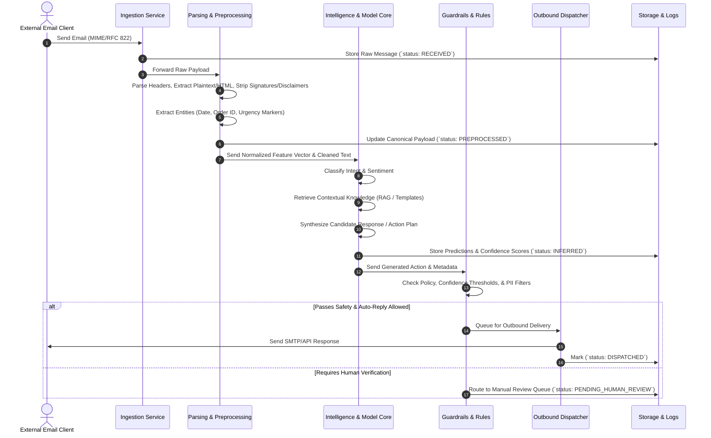

# End-to-End Data Flow

This document details how raw incoming messages are transformed, processed, enriched, evaluated by models, and routed for dispatch or review.

---

## 1. Sequence & Data Transformation Pipeline



---

## 2. Data Contracts at Each Pipeline Stage

### Stage 1: Ingestion Envelope
```json
{
  "message_id": "msg_89f023a1",
  "provider": "gmail",
  "raw_headers": {
    "from": "customer@example.com",
    "to": ["support@company.com"],
    "subject": "Urgent: Order #1042 damaged on arrival",
    "date": "2026-10-21T10:15:30Z"
  },
  "raw_payload": "Base64 or MIME byte string",
  "status": "RECEIVED"
}
```

### Stage 2: Normalized Document (Post-Parser)
```json
{
  "message_id": "msg_89f023a1",
  "clean_subject": "Order #1042 damaged on arrival",
  "clean_body": "Hello, I received my order #1042 today but the packaging was torn and the product inside is broken. Can I get a replacement?",
  "thread_history": [],
  "extracted_entities": {
    "order_ids": ["1042"],
    "sentiment": "negative",
    "urgency_flag": true
  },
  "status": "PREPROCESSED"
}
```

### Stage 3: Model Inference Output
```json
{
  "message_id": "msg_89f023a1",
  "predicted_intent": "order_replacement_request",
  "intent_confidence": 0.962,
  "requires_knowledge_retrieval": true,
  "retrieved_context_ids": ["policy_damaged_goods_v2"],
  "generated_draft": "Dear Customer,\n\nWe apologize for the damaged item in order #1042. We have initiated a replacement order...",
  "hallucination_score": 0.02,
  "status": "INFERRED"
}
```

### Stage 4: Guardrail & Dispatch Decision
```json
{
  "message_id": "msg_89f023a1",
  "action": "AUTO_REPLY",
  "confidence_threshold_met": true,
  "contains_pii_violation": false,
  "target_recipient": "customer@example.com",
  "status": "DISPATCHED",
  "timestamp": "2026-10-21T10:15:35Z"
}
```
