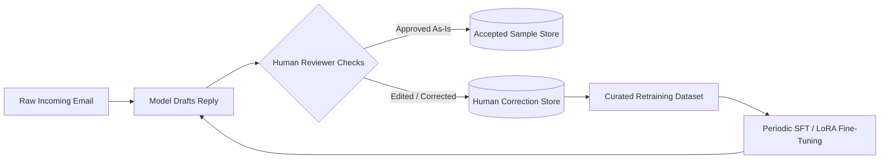

# Model Architecture & Learning Mechanics

This document explains the intelligence core, including how models are structured, trained, optimized, and evaluated.

---

## 1. Machine Learning & LLM Stack

The system employs a dual-tier intelligence architecture:

```
                          ┌───────────────────────────┐
                          │   Incoming Cleaned Email  │
                          └─────────────┬─────────────┘
                                        │
                 ┌──────────────────────┴──────────────────────┐
                 ▼                                             ▼
  ┌─────────────────────────────┐               ┌─────────────────────────────┐
  │ Tier 1: Fast Classifier     │               │ Tier 2: Generative Synthesizer│
  │ (RoBERTa / DeBERTa / SetFit)│               │ (LLM with RAG Context)      │
  ├─────────────────────────────┤               ├─────────────────────────────┤
  │ • Task: Intent & Urgency    │               │ • Task: Personalized Reply  │
  │ • Latency: < 40ms           │               │ • Latency: ~800ms - 1500ms  │
  │ • Output: Category & Probs  │               │ • Output: Structured Draft  │
  └─────────────────────────────┘               └─────────────────────────────┘
```

---

## 2. Tier 1: Intent & Category Classifier

### 2.1 Model Topology
- **Base Architecture:** Transformer Encoder (e.g., `distilbert-base-uncased`, `roberta-base`, or sentence-transformer embedding with logistic classification head).
- **Output Layer:** Linear classification head mapping the `[CLS]` token representation $\mathbf{h}_{\text{CLS}} \in \mathbb{R}^d$ to class logits $\mathbf{z} \in \mathbb{R}^K$:
  $$\mathbf{z} = \mathbf{W}\mathbf{h}_{\text{CLS}} + \mathbf{b}$$
  $$\hat{\mathbf{y}} = \text{softmax}(\mathbf{z})$$

### 2.2 Loss Function & Optimization
- **Loss:** Categorical Cross-Entropy:
  $$\mathcal{L}_{\text{CE}} = -\sum_{i=1}^{K} y_i \log(\hat{y}_i)$$
  *(With class weighting applied for imbalanced email categories).*
- **Optimizer:** `AdamW` ($\beta_1 = 0.9, \beta_2 = 0.999$, weight decay $= 0.01$).
- **Learning Rate Schedule:** Linear warmup for first 10% steps followed by cosine annealing decay.

---

## 3. Tier 2: Response Generation & Reasoning

### 3.1 Model Topology & Prompt Architecture
- **Engine:** Instruction-tuned autoregressive Language Model.
- **Context Injection (RAG):**
  - Customer profile & history retrieved from vector store / relational database.
  - Policy / FAQ chunks selected via cosine similarity over dense embeddings.
- **Inference Constraints:**
  - Strict JSON schema enforcement via structured outputs.
  - Temperature: $0.2$ - $0.4$ (low variance, high determinism).
  - Repetition penalty: $1.1$.

### 3.2 Continuous Learning & Feedback Loop



1. **Passive Collection:** High-confidence automated replies with positive customer follow-up are tagged as candidate positive examples.
2. **Active Feedback:** When a human agent edits a drafted email before sending, the pair `(Incoming Query + Context, Human Corrected Reply)` is stored as a high-value supervised fine-tuning (SFT) sample.
3. **LoRA Fine-Tuning:** Parameter-Efficient Fine-Tuning (PEFT/LoRA) is periodically executed on updated feedback samples to align tone and policy without catastrophic forgetting.

---

## 4. Evaluation Metrics

| Metric | Target Threshold | Description |
| :--- | :--- | :--- |
| **Intent Macro-F1** | $\ge 0.92$ | Balances performance across both frequent and rare customer intents. |
| **Urgency Recall** | $\ge 0.98$ | Critical priority: minimize false negatives on urgent or critical messages. |
| **Hallucination Rate** | $\le 1.0\%$ | Fraction of generated responses containing unverified factual claims. |
| **Acceptance Rate** | $\ge 85\%$ | Percentage of AI-generated drafts sent without substantial human edits. |
